# System Call Graph

This document provides a high-level system call graph showing how files depend on each other via require/import statements.

> **Note**: Edges represent actual `require()` / `import` relationships, not symbol-name matches. This ensures zero false positives.

## Architectural Overview

```mermaid
graph LR
    subgraph agents
        agents_Guru_js["Guru.js"]
        agents_Koshpal_js["Koshpal.js"]
        agents_Rakshak_js["Rakshak.js"]
        agents_Shilpi_js["Shilpi.js"]
        agents_Shishya_js["Shishya.js"]
        agents_Sutradhar_js["Sutradhar.js"]
        agents_Tark_js["Tark.js"]
        agents_TestAgent_js["TestAgent.js"]
        agents_TestDrona_js["TestDrona.js"]
        agents_Vaidya_js["Vaidya.js"]
        agents_Vishwakarma_js["Vishwakarma.js"]
    end
    subgraph bin
        bin_dashboard_js["dashboard.js"]
        bin_setu_auth_js["setu-auth.js"]
        bin_setu_init_js["setu-init.js"]
        bin_setup_js["setup.js"]
        bin_test_dashboard_js["test-dashboard.js"]
    end
    subgraph lib
        lib_Agent_js["Agent.js"]
        lib_AgentContextManager_js["AgentContextManager.js"]
        lib_AgentToolExecutor_js["AgentToolExecutor.js"]
        lib_Budget_js["Budget.js"]
        lib_Camera_js["Camera.js"]
        lib_Config_js["Config.js"]
        lib_Context_js["Context.js"]
        lib_Contractor_js["Contractor.js"]
        lib_CoreAgent_js["CoreAgent.js"]
        lib_Docker_js["Docker.js"]
        lib_LLM_js["LLM.js"]
        lib_Logger_js["Logger.js"]
        lib_Pariksha_js["Pariksha.js"]
        lib_SessionLogger_js["SessionLogger.js"]
        lib_SkillLoader_js["SkillLoader.js"]
        lib_SwarmProtocol_js["SwarmProtocol.js"]
        lib_auth_auth_store_js["auth-store.js"]
        lib_auth_basic_js["basic.js"]
        lib_auth_google_js["google.js"]
        lib_auth_profile_mgr_js["profile-mgr.js"]
        lib_db_js["db.js"]
        lib_llm_Anthropic_js["Anthropic.js"]
        lib_llm_BaseProvider_js["BaseProvider.js"]
        lib_llm_Ollama_js["Ollama.js"]
        lib_llm_OpenAI_js["OpenAI.js"]
        lib_llm_OpenAICompatible_js["OpenAICompatible.js"]
        lib_middleware_auth_js["auth.js"]
        lib_middleware_socketAuth_js["socketAuth.js"]
        lib_models_config_js["config.js"]
        lib_models_factory_js["factory.js"]
        lib_models_providers_anthropic_js["anthropic.js"]
        lib_models_providers_base_js["base.js"]
        lib_models_providers_google_js["google.js"]
        lib_models_providers_ollama_js["ollama.js"]
        lib_models_providers_openai_js["openai.js"]
        lib_onboarding_changed_files_js["changed-files.js"]
        lib_onboarding_codeowners_js["codeowners.js"]
        lib_onboarding_context_builder_js["context-builder.js"]
        lib_onboarding_dependency_engine_js["dependency-engine.js"]
        lib_onboarding_doc_enricher_js["doc-enricher.js"]
        lib_onboarding_doc_facts_js["doc-facts.js"]
        lib_onboarding_doc_links_js["doc-links.js"]
        lib_onboarding_drift_js["drift.js"]
        lib_onboarding_generator_js["generator.js"]
        lib_onboarding_governance_profiles_js["governance-profiles.js"]
        lib_onboarding_paths_js["paths.js"]
        lib_onboarding_status_js["status.js"]
        lib_routes_js["routes.js"]
        lib_routes_api_js["api.js"]
        lib_server_js["server.js"]
        lib_socket_js["socket.js"]
        lib_sockets_dashboard_js["dashboard.js"]
        lib_utils_js["utils.js"]
        lib_utils_JsonParser_js["JsonParser.js"]
        lib_utils_pkce_js["pkce.js"]
    end

    agents_Guru_js --> lib_CoreAgent_js
    agents_Guru_js --> lib_LLM_js
    agents_Guru_js --> lib_SkillLoader_js
    agents_Guru_js --> lib_db_js
    agents_Guru_js --> lib_utils_JsonParser_js
    agents_Koshpal_js --> lib_Context_js
    agents_Koshpal_js --> lib_Contractor_js
    agents_Koshpal_js --> lib_CoreAgent_js
    agents_Koshpal_js --> lib_LLM_js
    agents_Koshpal_js --> lib_SkillLoader_js
    agents_Koshpal_js --> lib_db_js
    agents_Rakshak_js --> lib_CoreAgent_js
    agents_Rakshak_js --> lib_LLM_js
    agents_Rakshak_js --> lib_SkillLoader_js
    agents_Rakshak_js --> lib_db_js
    agents_Shilpi_js --> lib_Context_js
    agents_Shilpi_js --> lib_Contractor_js
    agents_Shilpi_js --> lib_CoreAgent_js
    agents_Shilpi_js --> lib_LLM_js
    agents_Shilpi_js --> lib_SkillLoader_js
    agents_Shilpi_js --> lib_db_js
    agents_Shishya_js --> lib_CoreAgent_js
    agents_Shishya_js --> lib_LLM_js
    agents_Sutradhar_js --> lib_CoreAgent_js
    agents_Sutradhar_js --> lib_SwarmProtocol_js
    agents_Tark_js --> lib_Budget_js
    agents_Tark_js --> lib_Context_js
    agents_Tark_js --> lib_Contractor_js
    agents_Tark_js --> lib_CoreAgent_js
    agents_Tark_js --> lib_LLM_js
    agents_Tark_js --> lib_SkillLoader_js
    agents_Tark_js --> lib_db_js
    agents_TestAgent_js --> lib_Agent_js
    agents_TestDrona_js --> lib_db_js
    agents_Vaidya_js --> lib_Agent_js
    agents_Vaidya_js --> lib_Config_js
    agents_Vaidya_js --> lib_db_js
    agents_Vaidya_js --> lib_onboarding_context_builder_js
    agents_Vishwakarma_js --> lib_Context_js
    agents_Vishwakarma_js --> lib_Contractor_js
    agents_Vishwakarma_js --> lib_CoreAgent_js
    agents_Vishwakarma_js --> lib_LLM_js
    agents_Vishwakarma_js --> lib_db_js
    bin_dashboard_js --> lib_db_js
    bin_dashboard_js --> lib_onboarding_governance_profiles_js
    bin_dashboard_js --> lib_onboarding_status_js
    bin_setu_auth_js --> lib_auth_auth_store_js
    bin_setu_auth_js --> lib_auth_google_js
    bin_setu_init_js --> lib_db_js
    bin_setup_js --> lib_auth_profile_mgr_js
    bin_setup_js --> lib_llm_OpenAICompatible_js
    bin_setup_js --> lib_models_providers_google_js
    bin_test_dashboard_js --> lib_db_js
    lib_AgentContextManager_js --> lib_Config_js
    lib_AgentContextManager_js --> lib_LLM_js
    lib_Agent_js --> lib_Logger_js
    lib_Budget_js --> lib_db_js
    lib_Camera_js --> lib_Config_js
    lib_Camera_js --> lib_Logger_js
    lib_Context_js --> lib_Logger_js
    lib_CoreAgent_js --> lib_AgentContextManager_js
    lib_CoreAgent_js --> lib_AgentToolExecutor_js
    lib_CoreAgent_js --> lib_Agent_js
    lib_CoreAgent_js --> lib_Config_js
    lib_CoreAgent_js --> lib_LLM_js
    lib_CoreAgent_js --> lib_SessionLogger_js
    lib_CoreAgent_js --> lib_SkillLoader_js
    lib_CoreAgent_js --> lib_SwarmProtocol_js
    lib_Docker_js --> lib_Config_js
    lib_Docker_js --> lib_Logger_js
    lib_LLM_js --> lib_Config_js
    lib_LLM_js --> lib_models_factory_js
    lib_Pariksha_js --> lib_Logger_js
    lib_SkillLoader_js --> lib_Logger_js
    lib_auth_google_js --> lib_Config_js
    lib_auth_google_js --> lib_Logger_js
    lib_auth_google_js --> lib_auth_auth_store_js
    lib_auth_google_js --> lib_utils_pkce_js
    lib_auth_profile_mgr_js --> lib_auth_auth_store_js
    lib_llm_Anthropic_js --> lib_llm_BaseProvider_js
    lib_llm_Ollama_js --> lib_llm_BaseProvider_js
    lib_llm_OpenAICompatible_js --> lib_llm_BaseProvider_js
    lib_llm_OpenAI_js --> lib_llm_BaseProvider_js
    lib_middleware_auth_js --> lib_auth_basic_js
    lib_middleware_socketAuth_js --> lib_auth_basic_js
    lib_models_factory_js --> lib_auth_profile_mgr_js
    lib_models_factory_js --> lib_models_config_js
    lib_models_factory_js --> lib_models_providers_anthropic_js
    lib_models_factory_js --> lib_models_providers_google_js
    lib_models_factory_js --> lib_models_providers_ollama_js
    lib_models_factory_js --> lib_models_providers_openai_js
    lib_models_providers_anthropic_js --> lib_models_providers_base_js
    lib_models_providers_google_js --> lib_Config_js
    lib_models_providers_google_js --> lib_auth_google_js
    lib_models_providers_google_js --> lib_models_providers_base_js
    lib_models_providers_ollama_js --> lib_models_providers_base_js
    lib_models_providers_openai_js --> lib_Logger_js
    lib_models_providers_openai_js --> lib_models_providers_base_js
    lib_onboarding_context_builder_js --> lib_onboarding_dependency_engine_js
    lib_onboarding_context_builder_js --> lib_onboarding_doc_facts_js
    lib_onboarding_context_builder_js --> lib_onboarding_status_js
    lib_onboarding_doc_enricher_js --> lib_onboarding_dependency_engine_js
    lib_onboarding_doc_enricher_js --> lib_onboarding_doc_facts_js
    lib_onboarding_doc_enricher_js --> lib_onboarding_doc_links_js
    lib_onboarding_doc_enricher_js --> lib_onboarding_status_js
    lib_onboarding_doc_facts_js --> lib_onboarding_status_js
    lib_onboarding_drift_js --> lib_onboarding_changed_files_js
    lib_onboarding_drift_js --> lib_onboarding_codeowners_js
    lib_onboarding_drift_js --> lib_onboarding_governance_profiles_js
    lib_onboarding_drift_js --> lib_onboarding_paths_js
    lib_onboarding_drift_js --> lib_onboarding_status_js
    lib_onboarding_generator_js --> lib_onboarding_status_js
    lib_onboarding_governance_profiles_js --> lib_onboarding_paths_js
    lib_routes_api_js --> lib_db_js
    lib_routes_api_js --> lib_onboarding_governance_profiles_js
    lib_routes_api_js --> lib_onboarding_paths_js
    lib_routes_api_js --> lib_onboarding_status_js
    lib_routes_api_js --> lib_utils_js
    lib_routes_js --> lib_db_js
    lib_routes_js --> lib_middleware_auth_js
    lib_routes_js --> lib_onboarding_governance_profiles_js
    lib_routes_js --> lib_onboarding_paths_js
    lib_routes_js --> lib_onboarding_status_js
    lib_routes_js --> lib_utils_js
    lib_server_js --> lib_Logger_js
    lib_server_js --> lib_routes_js
    lib_server_js --> lib_socket_js
    lib_socket_js --> lib_db_js
    lib_socket_js --> lib_utils_js
    lib_sockets_dashboard_js --> lib_db_js
    lib_sockets_dashboard_js --> lib_utils_js

```

## Summary

- **71** files participate in the call graph
- **131** import edges detected
- **Agents** depend on **Lib** for core functionality (DB, LLM, Context, Agent base class).
- **CLI** tools in `bin/` orchestrate onboarding and the agent lifecycle.
